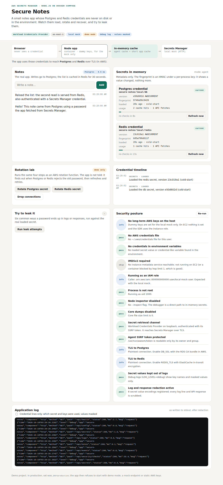
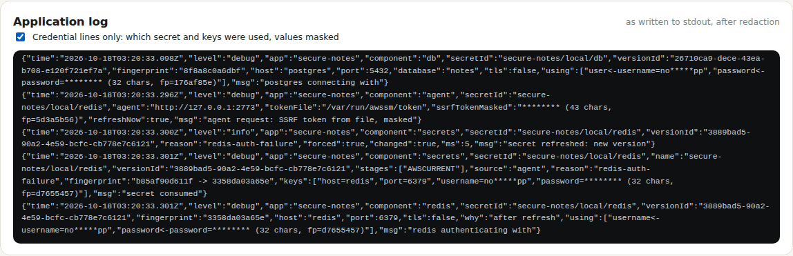

# Test case 9 — Agent mode

[← all test cases](README.md)

**What it proves:** the app can read its secrets through a local agent (the AWS Workload Credentials Provider on EC2) instead of calling Secrets Manager; the agent only answers requests carrying its token, which only the app can read.

**Catalogue IDs:** A1–A4 ([TEST-CASES.md](../docs/TEST-CASES.md)) · **Proven in CI by:** `compose (agent)` · **Evidence from:** [CI run 39093063634](https://github.com/ephico2real2/aws-secrets-manager-node-poc/actions/runs/39093063634), published on [`ci-captures`](https://github.com/ephico2real2/aws-secrets-manager-node-poc/tree/ci-captures)

## Steps

```bash
docker compose down -v
docker compose -f docker-compose.yml -f docker-compose.agent.yml up --build
COMPOSE_FILE=docker-compose.yml:docker-compose.agent.yml scripts/compose-check.sh
```

## What you should see

`mode: agent`, the `Workload Credentials Provider` badge, and two extra posture checks passing: the retrieval channel and **Agent SSRF token protected**.



## Evidence from the run

```
== secrets mode: agent
  ok    the agent served 4 secret fetch(es) to the app
  ok    the agent token is visible only to the agent and the app
  ok    the agent rejects a request without the SSRF token (403)
```

The app's debug log records where each token came from, masked:

```json
{
  "msg": "agent request: SSRF token from file, masked",
  "component": "agent",
  "secretId": "secure-notes/local/db",
  "agent": "http://127.0.0.1:2773",
  "tokenFile": "/var/run/awssm/token",
  "ssrfTokenMasked": "******** (43 chars, fp=5d3a5b56)",
  "refreshNow": false
}
```



The credential scan runs in this mode too and finds nothing.
