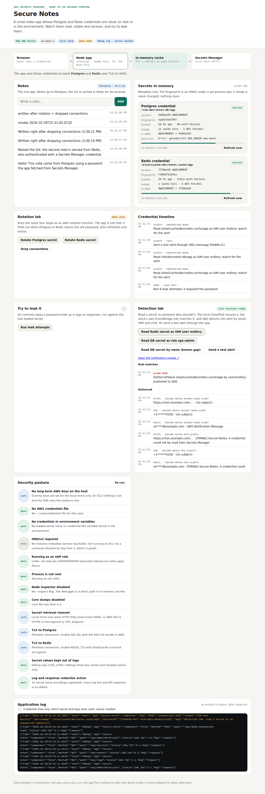

# Test case 13 — An intruder reads a secret: the alarm fires

[← all test cases](README.md)

**What it proves:** a read of a secret by an identity that shouldn't read it raises the CloudFormation stack's own EventBridge rule, and on-call gets an email, a text and a chat post within a second. The app's own reads, rotation and tooling never trip it. One known gap stays visible: a read that names the DB secret by its name is recorded but not alarmed.

**Catalogue IDs:** N1–N3, N7 ([TEST-CASES.md](../docs/TEST-CASES.md)) · **Proven in CI by:** `compose (sdk)`, `compose (agent)`, `kind`, `checks` · **Evidence from:** [CI run 39140499800](https://github.com/ephico2real2/aws-secrets-manager-node-poc/actions/runs/39140499800), published on [`ci-captures`](https://github.com/ephico2real2/aws-secrets-manager-node-poc/tree/ci-captures)

## Steps

```bash
docker compose up --build -d      # then open http://localhost:3000
```

1. In **Detection lab**, click **Read Redis secret as IAM user mallory**.
2. Click **Read DB secret by name (known gap)**.
3. Open the notification console (the **Open the notification console ↗** link, or http://localhost:4575).

From the command line, `scripts/alerts-check.sh compose` runs the same paths.

## What you should see

**Rule matches** shows `ALARM SENT`: `GetSecretValue /elasticache/dev/notes-cache/app by user/mallory: published to SNS`. **Delivered** lists one email, one SMS and one chat post on `secure-notes-secret-read-alert`, with every recipient masked. The by-name read adds a CloudTrail record but no delivery.



How it works: the AWS mock treats the dummy access key as the caller (`local-intruder-user` is mallory, `local-app` is the app's role). It writes a CloudTrail-shaped record **without the value** and evaluates the rule that `scripts/sync-event-pattern.py` copied from `infra/cloudformation.yaml`. CI fails if that copy goes stale. [Chapter 7](../docs/learn/07-alerts-and-audit.md#74-who-read-the-secret-the-unexpected-read-alarm) has the sequence diagram.

## Evidence from the run

```
== alerts: the local SNS, the stack's unexpected-read rule, the app's notifications
  ok    no unexpected-read alert before the test: the app, rotation and tooling reads are all expected
  ok    the smoke test's rotations sent a notification to the chat-only topic (it tells, it doesn't page)
  ok    reading the Redis secret as IAM user mallory raised the alarm: email, SMS and chat delivered
  ok    reading the DB secret by name is audited but not alarmed (the documented gap)
  ok    the test alert reached email, SMS and chat
  ok    recipients are masked in every delivery
```

Building this simulation found two bugs in the AWS version, which meant the alarm could never fire there:
1. The topic used the AWS-managed `aws/sns` key, which EventBridge can't use.
2. The rule lacked `State: ENABLED_WITH_ALL_CLOUDTRAIL_MANAGEMENT_EVENTS`, without which read-only events aren't delivered.

Both are fixed in the template. Proving it on AWS is story S12.5.
