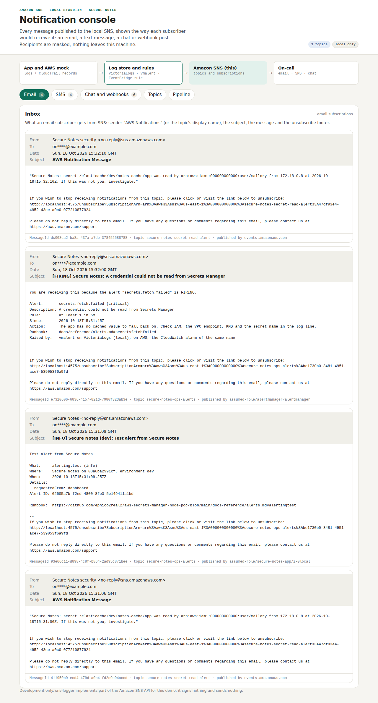
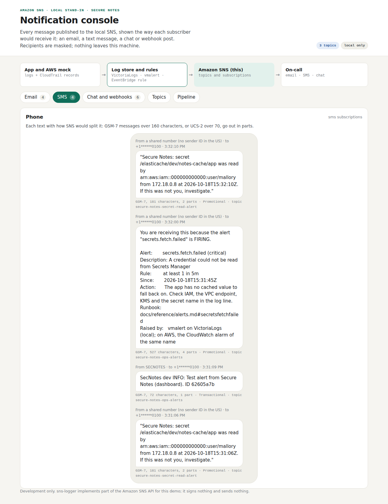

# Test case 14 — What on-call receives: email and SMS

[← all test cases](README.md)

**What it proves:** the local SNS (sns-logger) shows each message the way a subscriber would get it. Email has the sender, subject and unsubscribe footer. SMS shows GSM-7 or UCS-2 encoding and how many parts the text is split into. Recipients are masked in every view, and the test alert reaches every channel.

**Catalogue IDs:** N2, N5, N6, N12, N13 ([TEST-CASES.md](../docs/TEST-CASES.md)) · **Proven in CI by:** `compose (sdk)`, `kind`, `checks` · **Evidence from:** [CI run 39140499800](https://github.com/ephico2real2/aws-secrets-manager-node-poc/actions/runs/39140499800), published on [`ci-captures`](https://github.com/ephico2real2/aws-secrets-manager-node-poc/tree/ci-captures)

## Steps

1. Do [test case 13](test-case-13-detection-lab.md), then click **Send a test alert** in the Detection lab.
2. Open http://localhost:4575 and look at the **Email** and **SMS** tabs.

## What you should see

**Email.** The intruder alert comes from `Secure Notes security <no-reply@sns.amazonaws.com>` (the topic's display name) to `on****@example.com`. Its subject is SNS's default, `AWS Notification Message`, because an EventBridge input transformer sends no subject. The app's test alert has its own subject, a What/Where/When/Details block, an alert ID and a runbook link. The footer of each email shows the publisher: `events.amazonaws.com`, the app's role, or Alertmanager.



**SMS.** The test alert fits in one part (`SecNotes dev INFO: …`, sender ID `SECNOTES`, Transactional). The intruder alert is 181 characters, so it goes out in 2 parts. The Alertmanager alert reuses one message for every protocol, so its text runs to 4 parts. To shorten texts on AWS, give the SMS subscription its own topic or template. US numbers show no sender ID.



## Evidence from the run

```
  ok    the test alert reached email, SMS and chat
  ok    recipients are masked in every delivery
```

The unit tests (`backend/test/logging.test.js` and `dev/aws-mock/test/mock.test.js`) cover SNS's own rules:
- a subject under 100 characters with no line breaks;
- a `default` key in `MessageStructure=json`;
- 256 KiB per message;
- 1600 bytes per SMS;
- segment arithmetic;
- a registered secret value in an alert's details comes out as `[REDACTED]`.
