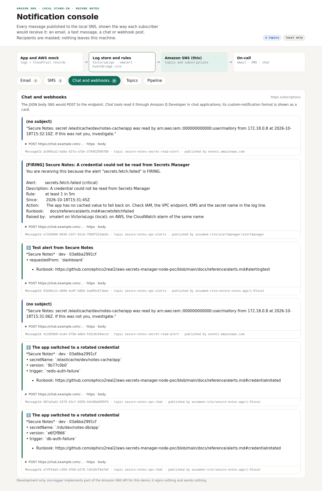

# Test case 15 — Chat: a rotation tells, it doesn't page

[← all test cases](README.md)

**What it proves:** when the app switches to a rotated credential, it posts a notification to the chat-only topic (`secure-notes-ops-chat`): no email, no SMS. The chat body uses the Amazon Q Developer custom-notification format, which is how an SNS topic reaches Slack or Teams on AWS.

**Catalogue IDs:** N4 ([TEST-CASES.md](../docs/TEST-CASES.md)) · **Proven in CI by:** `compose (sdk)`, `compose (agent)`, `kind` · **Evidence from:** [CI run 39140499800](https://github.com/ephico2real2/aws-secrets-manager-node-poc/actions/runs/39140499800), published on [`ci-captures`](https://github.com/ephico2real2/aws-secrets-manager-node-poc/tree/ci-captures)

## Steps

1. Do [test case 2](test-case-02-rotate-postgres.md) (rotate Postgres, drop connections) and [test case 3](test-case-03-rotate-redis.md).
2. Open http://localhost:4575 → **Chat and webhooks**.

## What you should see

One card per rotation, **The app switched to a rotated credential**, showing:
- the secret name;
- the new version (the first 8 characters of the version ID, not the value);
- what triggered the switch (`db-auth-failure` or `redis-auth-failure`);
- a runbook link.

Each card was published by the app's role to `secure-notes-ops-chat`. **▸ POST … body** opens the exact JSON SNS would send. The same tab also shows the intruder alert and the Alertmanager alert as they reach a webhook.



A notification is sent once per secret per 10 minutes. A single rejected password that recovers pages nobody. Three rejections in five minutes raise the `db.auth.rejected` warning, which also goes to chat.

## Evidence from the run

```
  ok    the smoke test's rotations sent a notification to the chat-only topic (it tells, it doesn't page)
```
