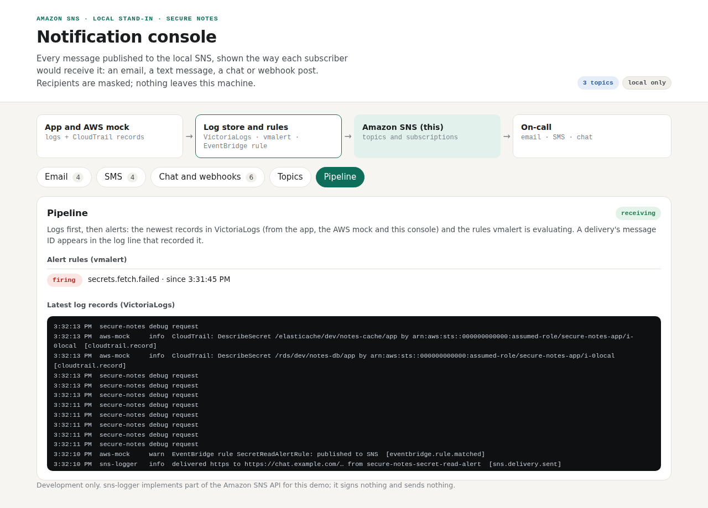

# Test case 16 — Logs first, then alerts: a real failure pages on-call

[← all test cases](README.md)

**What it proves:** the app doesn't page anyone itself. It writes a log line with `event=secrets.fetch.failed`, shipped as OpenTelemetry to VictoriaLogs. A vmalert rule generated from the alert catalogue fires, and Alertmanager publishes it to SNS. On AWS, the same chain runs through CloudWatch Logs, a metric filter and an alarm generated from the same catalogue.

**Catalogue IDs:** N8–N10, N17 ([TEST-CASES.md](../docs/TEST-CASES.md)) · **Proven in CI by:** `compose (sdk)` (with the observability overlay), `checks` · **Evidence from:** [CI run 39142364657](https://github.com/ephico2real2/aws-secrets-manager-node-poc/actions/runs/39142364657), published on [`ci-captures`](https://github.com/ephico2real2/aws-secrets-manager-node-poc/tree/ci-captures)

## Steps

```bash
export COMPOSE_FILE=docker-compose.yml:docker-compose.observability.yml
docker compose up --build -d
docker compose stop aws-mock                      # Secrets Manager is now unreachable
curl -s -X POST -H 'Content-Type: application/json' -d '{}' http://localhost:3000/api/secrets/db/refresh
docker compose start aws-mock
# about a minute later: http://localhost:4575 → Email, then Pipeline
unset COMPOSE_FILE
```

`scripts/pipeline-check.sh` does exactly this. The log store has its own UI at http://localhost:9428/select/vmui.

## What you should see

The refresh answers HTTP 500, and the app keeps serving its cached credential. The **Pipeline** tab shows the rule `secrets.fetch.failed` as **firing**, under the newest records from the app, the AWS mock (its CloudTrail records) and the console itself. The **Email** tab has `[FIRING] Secure Notes: A credential could not be read from Secrets Manager`, with the rule, the first action and the runbook, published by Alertmanager's identity. The same alert goes to SMS and chat.



## Evidence from the run

```
== records in VictoriaLogs (shipped as OpenTelemetry logs)
  ok    secure-notes: 204 records
  ok    aws-mock: 87 records
  ok    sns-logger: 16 records
  ok    CloudTrail-shaped records from the AWS mock: 86
== a real failure becomes an alert: Secrets Manager unreachable during a forced refresh
  forced refresh with the mock stopped answered HTTP 500 (the app keeps serving its cached value)
  ok    the failure is in the log store with event secrets.fetch.failed
  ok    vmalert -> Alertmanager -> SNS delivered the critical alert by email, SMS and chat
  ok    published by Alertmanager's identity
== the notification console sees the log store
  ok    sns-logger's Pipeline tab reads VictoriaLogs
```

### A warning tells, it doesn't page (N17)

A burst of error lines fires the pattern rule `app.errors.burst`, a `warning`, so Alertmanager sends it to the chat topic only. `pipeline-check.sh` makes the burst with three forced refreshes while the mock is stopped (the refresh route allows one per secret every 2 s). From [CI run 39174954533](https://github.com/ephico2real2/aws-secrets-manager-node-poc/actions/runs/39174954533), job `compose (sdk)`:

```
== a warning goes to chat only: a burst of errors in the app log (pattern rule app.errors.burst)
  error lines from the app in the log store: 6 (the rule fires at 5 in 5m)
  ok    one delivery, to the chat topic: vmalert -> Alertmanager -> SNS
  ok    no page: nothing on the alerts topic, so no email and no SMS
```

The check fails if the route is changed to page: pointed at the alerts receiver, the burst arrived as email, SMS and chat, and both lines said `FAIL`.
