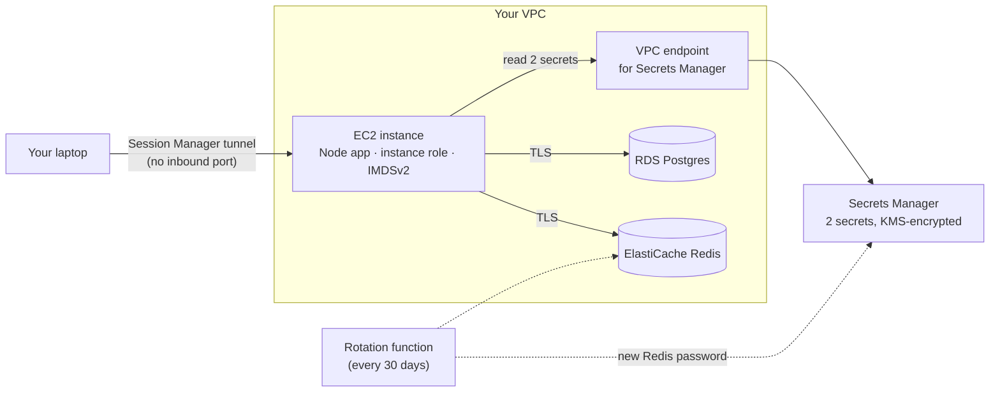
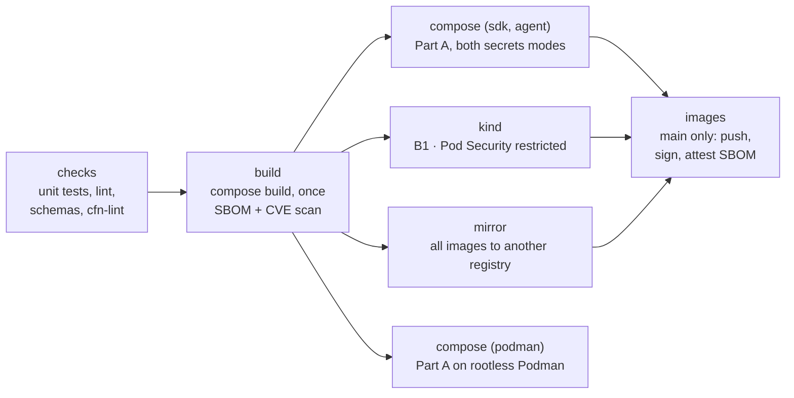

# Run and Deploy Secure Notes — Step-by-Step Guide

_Last updated October 17, 2026. The [README](../README.md) is the short version; this guide walks through every step._

Secure Notes runs three ways, all from the same two container images: on your laptop with Docker Compose, on Kubernetes or OpenShift, and on AWS on an EC2 server. Pick the part that matches where you want to run it; you don't need to do them in order.

## Pick your path

| Part | Where it runs | Secrets come from | You need | Time |
| --- | --- | --- | --- | --- |
| **A. Docker Compose** | Your laptop | A Secrets Manager stand-in, in a container | Docker | 5 min |
| **B. Kubernetes or OpenShift** | kind, OpenShift Local or a dev cluster; or EKS / ROSA | The stand-in inside the cluster, or real Secrets Manager on EKS / ROSA | kubectl or oc (plus Docker and kind for B1) | 10 to 20 min |
| **C. AWS on EC2** | An EC2 server that CloudFormation builds | Real Secrets Manager | An AWS account | About 1 hour, mostly waiting |

New to all of this? Do Part A first. It takes five minutes, needs no account, and shows you everything the app does before you deploy it anywhere.

**One build, everywhere.** `docker compose build` (which Part A runs for you) is the only place images are built. Part B loads those exact images into kind; on every push to `main`, CI publishes the images that passed its tests to GitHub's container registry for OpenShift and EKS to pull.

**How to read this guide:**

- Every grey command block is copy-paste.
- Text in `<angle brackets>` is something you replace with your own value.
- Run commands in a terminal, from the `aws-secrets-manager-node-poc` folder, unless the step says otherwise.
- Each step ends with a **Check**. Don't move on until it passes.

## Get the code

Every part starts from the project's GitHub repository, [ephico2real2/aws-secrets-manager-node-poc](https://github.com/ephico2real2/aws-secrets-manager-node-poc).

```bash
git clone https://github.com/ephico2real2/aws-secrets-manager-node-poc.git
cd aws-secrets-manager-node-poc
ls
```

**Check:** `ls` lists `backend`, `frontend`, `deploy`, `dev`, `infra`, `scripts`, `docker-compose.yml` and `README.md`.

No git? On the repository page, choose **Code → Download ZIP**, unzip it, and `cd` into the folder.

**On Windows,** run everything inside WSL (Ubuntu). The scripts are bash and won't run in PowerShell.

## Part A — Run locally with Docker Compose

The quickest way to see the app: no AWS account, no Kubernetes, only a container engine (Docker, or Podman). Everything AWS would normally provide runs in containers, including a stand-in for Secrets Manager.

**You need:** Docker Desktop, running, or Podman with the docker CLI pointed at it ([Podman instead of Docker](#podman-instead-of-docker)). Check with `docker compose version`; it should print a version number. Node.js 22 is only needed for the optional tests in step 3.

1. Build the images and start everything:

   ```bash
   docker compose up --build
   ```

   The first run takes a few minutes while Docker downloads and builds. Wait until the log shows `secure-notes listening`.
2. Open <http://localhost:3000> and try it: add a note, click **Rotate Postgres secret**, then **Drop connections**, then **Run leak attempts**. Watch the Credential timeline record each step.

   Then try the alerts. In **Detection lab**, click **Read Redis secret as IAM user mallory**, and open the notification console at <http://localhost:4575> (or the **Open the notification console** link). The alert is there as an email, a text message and a chat post, the way on-call would receive it. Nothing is sent anywhere: the console is a local stand-in for Amazon SNS.
3. Optional: in a second terminal, run the unit tests and the end-to-end check:

   ```bash
   (cd backend && npm install && npm test)
   scripts/compose-check.sh
   ```

   **Check:** the tests end with `# fail 0`, and `compose-check.sh` ends with `All checks passed` and then a section of alert checks, each `ok`.
4. Stop and reset. Press `Ctrl+C` in the first terminal, then:

   ```bash
   docker compose down -v
   ```

   `-v` deletes the data, so the next start creates new random passwords. It also frees ports 3000 and 4575.

**Optional: agent mode.** On EC2 the app can read its secrets through a local AWS agent instead of calling Secrets Manager itself (`SecretsMode=agent` in C4). To try that here, start the stack with a second file:

```bash
docker compose -f docker-compose.yml -f docker-compose.agent.yml up --build
```

The dashboard looks the same, and **Secrets in memory** shows `mode: agent`. The agent only answers requests that carry its token, which only it and the app can read.

**Optional: the log pipeline.** To see alerts raised from logs, as CloudWatch does on AWS, add the observability file. It starts four more containers (about 600 MB of images): an OpenTelemetry Collector, VictoriaLogs (the log store), vmalert (the alert rules) and Alertmanager.

```bash
docker compose -f docker-compose.yml -f docker-compose.observability.yml up --build
```

The log store's own screen is at <http://localhost:9428/select/vmui>, and the console's **Pipeline** tab shows the newest records and which rules are firing. To make one fire, follow [tutorial step 10](TUTORIAL.md#10-alerts-read-a-secret-as-an-intruder), or run `scripts/pipeline-check.sh`.

**What that one command started:**

| Container | Image | What it does |
| --- | --- | --- |
| `app` | `secure-notes-app:dev` (built here) | The Node.js app and dashboard |
| `aws-mock` | `secure-notes-aws-mock:dev` (built here) | Stands in for Secrets Manager, STS, CloudTrail and the stack's EventBridge alarm rule; local and CI only |
| `sns-logger` | `secure-notes-aws-mock:dev` | Stands in for Amazon SNS and shows each delivery on <http://localhost:4575>; local and CI only |
| `seed` | `secure-notes-app:dev` | Runs once: puts random passwords into Secrets Manager, applies them to Postgres and Redis, then disables the startup passwords |
| `postgres` | `postgres:16` | The database |
| `redis` | `redis:7-alpine` | The cache |

**Why is there a password in docker-compose.yml?** `bootstrap-only-change-me` only lets the seed job log in the first time. The seed job immediately replaces it with a random value stored only in Secrets Manager, and CI checks on every push that the old one no longer works.

## Part B — Run on Kubernetes or OpenShift

The same images run on any Kubernetes cluster. Pick B1 for a local kind cluster, B2 for OpenShift, or B3 for EKS or ROSA against real AWS. The manifests live in `deploy/k8s/` as Kustomize overlays:

| Overlay | Use it for | What it adds to the base |
| --- | --- | --- |
| `overlays/kind` | kind, or any local Kubernetes | Postgres, Redis, the AWS stand-in, the local SNS (sns-logger) and the seed job, inside the cluster; Pod Security `restricted` enforced on the namespace; the app and the console on NodePorts that kind maps to `localhost:3000` and `localhost:4575` |
| `overlays/openshift` | OpenShift Local (CRC) or a dev cluster | The same, plus two TLS Routes (the app, and the notification console); images pulled from GHCR; no fixed user IDs, so OpenShift assigns them |
| `overlays/openshift-local` | OpenShift Local on an Apple-silicon Mac, or any cluster that can't pull from GHCR | The OpenShift overlay with images built on the cluster from your checkout (`scripts/openshift-build.sh`) |
| `overlays/aws` | EKS, or ROSA with STS | Only the app, against real RDS, ElastiCache and Secrets Manager, with AWS access through an IAM role on the service account (IRSA) |

The base is hardened in every overlay: non-root, read-only root filesystem, all Linux capabilities dropped, seccomp on, no service-account token, and default-deny NetworkPolicies. The app's credentials never become a Kubernetes Secret: the only Secret in the namespace is the one-time startup secret.

### B1 — kind (Kubernetes on your laptop)

**You need:** Docker (or Podman: see below), [kind](https://kind.sigs.k8s.io) (CI uses v0.33.0) and kubectl, and 4 GiB of memory for the container VM: the running lab used 1.5 GiB of it on a MacBook. On a Mac, `scripts/bootstrap/macos.sh` installs what's missing; on Linux, `scripts/bootstrap/linux.sh`. Then check the machine:

```bash
scripts/preflight.sh kind
```

**Check:** the last line is `preflight: ready for the kind lab.` Ports 3000 and 4575 must be free, so stop Docker Compose first (`docker compose down`), or give kind other ports with `KIND_APP_PORT=3100 KIND_CONSOLE_PORT=4675`.

1. Create the cluster. It reads `deploy/kind/cluster.yaml`, which pins the Kubernetes version and maps the app and the console to your machine (on `127.0.0.1` only), so no port-forward is needed:

   ```bash
   scripts/kind-up.sh
   ```
2. Build the images with Docker Compose and load them into kind. These are the same images Part A runs; nothing is built twice.

   ```bash
   scripts/images-build.sh
   ```
3. Deploy and wait:

   ```bash
   scripts/k8s-deploy.sh deploy/k8s/overlays/kind
   ```

   It waits for Postgres, Redis and the stand-in, then the seed job, then the app. The app pod may restart once or twice while the seed job finishes; that's expected.
4. Open <http://localhost:3000>. The header says **Node.js on Kubernetes**. The notification console (the Detection lab's link) is on <http://localhost:4575>.
5. Collect the evidence:

   ```bash
   scripts/k8s-check.sh
   ```

   It shows which user each container runs as and the Secrets in the namespace, proves the startup passwords were disabled and that Postgres only ever received password hashes, then runs the end-to-end test.

   **Check:** the last line is `k8s-check: all checks passed`.

When you're done: `scripts/kind-down.sh`. The images stay in Docker for next time.

A cluster made before `deploy/kind/cluster.yaml` existed has no port mappings; `kind-up.sh` says so. Recreate it, or use `kubectl -n secure-notes port-forward svc/secure-notes 3000:80` and `svc/sns-logger 4575:4575`.

#### Podman instead of Docker

Podman runs Part A and B1 in a smaller VM than Docker Desktop. The scripts call `docker`; the docker CLI talks to Podman through the Podman machine's API socket, and kind runs its node through Podman. On a Mac:

```bash
scripts/bootstrap/macos.sh --podman      # Podman Desktop, a 4 GiB machine if you have none, then the preflight
. scripts/podman.env                      # DOCKER_HOST at Podman's socket, KIND_EXPERIMENTAL_PROVIDER=podman
```

Then Part A and steps 1 to 5 above, unchanged. Source `scripts/podman.env` in every new terminal (or from your shell profile); it works in bash and zsh, on macOS and Linux. CI runs Part A this way on every push (`compose (podman)`).

**Check:** `scripts/preflight.sh kind` shows `Podman engine` in the docker row and `ok  kind provider  podman`.

**Without Docker Desktop.** The docker CLI then comes from Homebrew: `macos.sh --podman` installs the `docker` and `docker-compose` formulae when no `docker` is on your `PATH`. Compose is a CLI plugin, so tell the docker CLI where Homebrew put it, as the bootstrap prints and Homebrew's own caveat says:

```json
{ "cliPluginsExtraDirs": ["/opt/homebrew/lib/docker/cli-plugins"] }
```

in `~/.docker/config.json` (or `$DOCKER_CONFIG/config.json`). **Check:** `docker compose version` prints a version. Proven with Homebrew's docker 29.9.1 and docker-compose 5.6.0 on Podman 6.1.2: `compose-check.sh` passed, with Docker Desktop's CLI off the `PATH` and an empty `DOCKER_CONFIG`.

Proven on a MacBook (Apple silicon) with Podman 6.1.2, rootless, 4 CPUs and 4 GiB: `compose-check.sh` and `k8s-check.sh` passed ([test case 10](../demo/test-case-10-kubernetes.md#the-same-lab-on-a-macbook-on-podman-instead-of-docker)). CI runs Part A on Podman too (rootless, on Linux); kind runs on Docker there. The log pipeline fits too: Compose with `docker-compose.observability.yml` used 1.0 GiB of the 4 GiB, and `pipeline-check.sh` passed. If a lab ever needs more memory, resize the machine: `podman machine stop && podman machine set --memory 6144 && podman machine start`.

### B2 — OpenShift

**You need:** `oc`, logged in to a cluster as a user who can create a project. OpenShift Local (CRC) on a laptop works: give it at least 9 GiB and 4 CPUs (`crc config set memory 10240`), then `crc start`, `eval $(crc oc-env)` and `oc login -u developer https://api.crc.testing:6443`. Check with `scripts/preflight.sh openshift`.

1. Create the project and deploy. Pick one:

   ```bash
   oc new-project secure-notes

   # the published images (amd64 clusters that can pull from ghcr.io)
   KUBECTL=oc scripts/k8s-deploy.sh deploy/k8s/overlays/openshift

   # or: build the images on the cluster from your checkout (Apple-silicon Macs,
   # where the published amd64 images can't run, or no access to ghcr.io)
   scripts/openshift-build.sh
   ```

   `openshift-build.sh` creates two BuildConfigs, uploads the committed source (`git archive` of HEAD), builds it on the cluster for the cluster's own CPU, and deploys `deploy/k8s/overlays/openshift-local`.
2. The deploy prints two addresses, both HTTPS through the OpenShift router:

   ```
   app:                  https://secure-notes-secure-notes.apps-crc.testing
   notification console: https://sns-logger-secure-notes.apps-crc.testing
   ```

   Open the app. The header says **Node.js on OpenShift**, and **Security posture** shows the high user ID OpenShift assigned. The Detection lab's console link points at the second Route; the deploy script sets that once the router has admitted it. OpenShift Local's certificate is self-signed, so the browser asks you to accept it once for each address.
3. Collect the evidence:

   ```bash
   oc -n secure-notes port-forward svc/secure-notes 3000:80 &
   KUBECTL=oc scripts/k8s-check.sh
   ```

   **Check:** the last line is `k8s-check: all checks passed`.

**Cluster can't reach ghcr.io or Docker Hub?** Copy the four images into a registry it can reach. Log in to that registry first (`skopeo login`, `podman login` or `oc registry login`), then:

```bash
scripts/mirror-images.sh <your-registry>/<path>
KUBECTL=oc scripts/k8s-deploy.sh deploy/k8s/overlays/mirror
```

The script copies the app, the stand-in, Postgres and Redis with `skopeo` (or `oc image mirror` if you set `MIRROR_TOOL=oc`), writes the `mirror` overlay, and checks that every image in it comes from your registry. If the registry needs a login to pull, also create a pull secret and link it to the `secure-notes` and `default` service accounts.

Why no fixed user IDs: OpenShift's restricted-v2 policy starts every container as a random high user ID with group 0, and rejects pods that ask for a specific one. CI tests the Kubernetes deployment on kind (B1), which runs the same base and backing services; this overlay only adds the Routes, a NetworkPolicy that lets the router reach the console, and the image names, and leaves the user IDs to OpenShift. The check in step 3 confirms it on your cluster.

CI has no OpenShift cluster. It renders and validates both OpenShift overlays on every push, but the Routes and `openshift-build.sh` are proven only when you run them; tell us if a step doesn't behave as written.

### B3 — EKS or ROSA, against real AWS

**You need:** an EKS cluster (or ROSA with STS) with an IAM OIDC provider; Postgres on RDS, Redis on ElastiCache with TLS and an RBAC user, and their two secrets in Secrets Manager (Part C's stack creates all of these); and network access from the pods to them.

1. Create the IAM role the pod will use. Replace `ACCOUNT_ID` and `OIDC_PROVIDER` in `infra/irsa-trust-policy.example.json`, and the ARNs in `infra/iam-policy.example.json`, then:

   ```bash
   aws iam create-role --role-name secure-notes-pod \
     --assume-role-policy-document file://infra/irsa-trust-policy.example.json
   aws iam put-role-policy --role-name secure-notes-pod --policy-name read-own-secrets \
     --policy-document file://infra/iam-policy.example.json
   ```

   The permissions policy only works through a Secrets Manager VPC endpoint (`aws:SourceVpce`). If your cluster's VPC has none, delete that `Condition` block.
2. Fill in every `<PLACEHOLDER>` in `deploy/k8s/overlays/aws/kustomization.yaml`: region, the two secret ARNs, the RDS and ElastiCache endpoints, and the role ARN from step 1.
3. Create the namespace and the RDS certificate bundle the app uses to verify the database:

   ```bash
   kubectl create namespace secure-notes
   curl -fsSLo global-bundle.pem https://truststore.pki.rds.amazonaws.com/global/global-bundle.pem
   kubectl -n secure-notes create configmap rds-ca --from-file=global-bundle.pem
   ```
4. Deploy:

   ```bash
   scripts/k8s-deploy.sh deploy/k8s/overlays/aws
   ```
5. Port-forward and open the app as in B1.

   **Check:** **Security posture** shows **Running as an IAM role: pass**, with an ARN that contains `assumed-role`.

On EKS you can use Pod Identity instead of IRSA: skip the annotation, and create a Pod Identity association for the `secure-notes` service account in the `secure-notes` namespace. On a cluster outside AWS, IAM Roles Anywhere is the keyless option, exchanging an X.509 certificate for temporary credentials.

## Part C — Deploy to AWS on EC2

This part builds the real thing in your AWS account: the app on an EC2 server, reading its Postgres and Redis passwords from Secrets Manager with no password stored anywhere you can see. Steps C0 to C10 take about an hour, most of it waiting while AWS builds the database and cache. Doing Part A first is the best way to know what to expect.

### What the stack builds

One CloudFormation template creates every piece for you:

| Piece | What it is | Why it's there |
| --- | --- | --- |
| EC2 instance | Amazon Linux 2023 server running the Node app | Runs the app, with no inbound ports open |
| IAM role | The identity the server uses | Lets the app read its two secrets and nothing else |
| RDS Postgres | Managed database | Stores the notes; RDS creates and rotates its password |
| ElastiCache Redis | Managed cache | Caches the notes list, over TLS, with its own user |
| Secrets Manager | 2 secrets | The database password (made by RDS) and the Redis password (generated) |
| KMS key | Encryption key | Encrypts the secrets, the database disk and the cache |
| VPC endpoint | Private door to Secrets Manager | Secret requests never cross the public internet |
| Security groups | Firewalls | Only the server can reach the database and cache |
| Rotation function | A small Lambda function | Changes the Redis password every 30 days; RDS rotates the database one |
| Alerts | 3 SNS topics, an EventBridge rule, CloudWatch Logs and alarms | Emails, texts or chat posts when someone unexpected reads a secret or the app logs a critical problem ([alerts](reference/alerts.md)) |



Nothing on the internet can connect to the server. It reads its two secrets through the VPC endpoint, then uses them to log in to the database and cache over TLS.

**Cost:** approximately $2 to $3 a day while it runs, because EC2, RDS, ElastiCache and the VPC endpoint bill by the hour (approximate; check the AWS Pricing Calculator for your region). Delete the stack when you finish (C10).

### C0 — Before you start

**AWS account.** You need permission to create IAM roles, EC2, RDS, ElastiCache, KMS keys and CloudFormation stacks. The simplest setup is `AdministratorAccess` on a personal or sandbox account. On a work account, ask your lead which account and role to use.

**Tools.** Install each one, then run its check command.

| Tool | Check command | What you should see | Install guide |
| --- | --- | --- | --- |
| AWS CLI v2 | `aws --version` | `aws-cli/2.` followed by numbers | [Install the AWS CLI](https://docs.aws.amazon.com/cli/latest/userguide/getting-started-install.html) |
| Session Manager plugin | `session-manager-plugin` | A message saying it installed successfully | [macOS](https://docs.aws.amazon.com/systems-manager/latest/userguide/install-plugin-macos-overview.html) · [Ubuntu/WSL](https://docs.aws.amazon.com/systems-manager/latest/userguide/install-plugin-debian-and-ubuntu.html) |
| zip | `zip -v` | Version info | Built into macOS; on Ubuntu run `sudo apt install zip` |

**Check:** all three commands work, and you're in the `aws-secrets-manager-node-poc` folder from "Get the code".

### C1 — Sign in to AWS from the terminal

Sign in with IAM Identity Center so the CLI gets temporary credentials that expire on their own. Don't create access keys.

1. Start the setup wizard:

   ```bash
   aws configure sso
   ```
2. Answer its questions:
   - **SSO session name:** anything, for example `my-sso`.
   - **SSO start URL:** your portal address, like `https://<something>.awsapps.com/start`. Your admin has it, or find it in the IAM Identity Center console.
   - **SSO region:** the region where Identity Center lives (ask if unsure).
   - **Registration scopes:** press Enter.
3. A browser tab opens. Approve the request.
4. Back in the terminal, pick your account and role. Then set **default region** to `us-east-1` (or your region), **output** to `json`, and **profile name** to `secure-notes`.

Now set the variables the rest of this guide uses:

```bash
export AWS_PROFILE=secure-notes
export AWS_REGION=us-east-1
export STACK=secure-notes
```

These variables only live in the current terminal window. If you open a new window, run the three `export` lines again. If a command later says your token expired, run `aws sso login`.

**Check:**

```bash
aws sts get-caller-identity
```

You should see your 12-digit account number and an `Arn` that contains `assumed-role`.

**No Identity Center in your account?** Ask your admin to turn it on. As a last resort, create a personal access key, keep it only on your laptop, and delete it when you finish this guide. Never copy it onto the server.

### C2 — Pick your network

The template builds into a network (VPC) that already exists, so you need three IDs: the VPC and two subnets in different Availability Zones. The server's subnet must have outbound internet so it can install packages.

| Option | When to use it | Outbound internet comes from |
| --- | --- | --- |
| **A. Default VPC** | Learning and demos (this guide) | The server gets a public IP; its firewall still allows no inbound traffic |
| **B. Private subnets** | Anything real | A NAT gateway (ask your cloud or network team which subnets to use) |

**Option A — find the default VPC and its subnets:**

```bash
export VPC=$(aws ec2 describe-vpcs --filters Name=is-default,Values=true --query 'Vpcs[0].VpcId' --output text)
echo $VPC
aws ec2 describe-subnets --filters Name=vpc-id,Values=$VPC --query 'Subnets[].[SubnetId,AvailabilityZone]' --output table
```

If `echo $VPC` prints `None`, this region has no default VPC; use Option B.

From the table, pick two subnets whose Availability Zones are different (for example `us-east-1a` and `us-east-1b`):

```bash
export SUBNET_A=<first subnet-id>
export SUBNET_B=<second subnet-id, different zone>
```

**Option B** uses the same two `export` lines: `SUBNET_A` must route out through a NAT gateway; `SUBNET_B` is any private subnet in a different zone.

**Is there already a Secrets Manager endpoint in this VPC?** A VPC can only have one with private DNS, so check:

```bash
aws ec2 describe-vpc-endpoints --filters Name=vpc-id,Values=$VPC Name=service-name,Values=com.amazonaws.$AWS_REGION.secretsmanager --query 'VpcEndpoints[].VpcEndpointId' --output text
```

No output is the normal case. If it prints an ID like `vpce-0abc…`, write it down; C4 tells you where it goes.

**Check:**

```bash
echo $VPC $SUBNET_A $SUBNET_B
```

You should see three IDs: one starting `vpc-` and two starting `subnet-`.

### C3 — Upload the app to S3

When the server first boots, it downloads the app from a private S3 bucket, so the code has to be there before you deploy.

Bucket names are global across all of AWS. Adding your account number and region makes yours unique:

```bash
export BUCKET=secure-notes-artifacts-$(aws sts get-caller-identity --query Account --output text)-$AWS_REGION
aws s3 mb s3://$BUCKET
```

New buckets block public access by default. Leave it that way.

Now zip the app and upload it:

```bash
./scripts/package.sh $BUCKET
```

If you see `Permission denied`, run `chmod +x scripts/package.sh` and try again.

**Check:**

```bash
aws s3 ls s3://$BUCKET/secure-notes/
```

You should see `app.zip` with today's date.

### C4 — Deploy the CloudFormation stack

One command builds everything. It runs for about 25 to 40 minutes, mostly waiting on RDS and ElastiCache, so start it and go get a coffee.

```bash
aws cloudformation deploy \
  --stack-name $STACK \
  --template-file infra/cloudformation.yaml \
  --capabilities CAPABILITY_IAM \
  --parameter-overrides \
    VpcId=$VPC \
    AppSubnetId=$SUBNET_A \
    DataSubnetIds=$SUBNET_A,$SUBNET_B \
    AppArtifactBucket=$BUCKET
```

What the pieces mean:

- `--stack-name` is the name for this whole group of resources. Keep it short and lowercase, with letters, numbers and hyphens only, starting with a letter. The template uses it in ElastiCache user names, which reject anything else.
- `--capabilities CAPABILITY_IAM` is you saying "yes, I know this creates an IAM role." CloudFormation refuses without it.
- `--parameter-overrides` fills in the template's blanks with the IDs from C2 and C3.

**Found an existing endpoint in Step 3?** Add these two values on the last line, after `AppArtifactBucket=$BUCKET`:

```bash
    CreateSecretsManagerEndpoint=false ExistingSecretsManagerEndpointId=<vpce-id>
```

**Want alerts?** Add any of these on the last line too. There are three alert topics
(unexpected secret reads, critical app alarms, and chat for warnings), and each one asks
you to confirm separately. So `AlertEmail` brings up to three confirmation emails: confirm
**every one**, or that topic sends you nothing. For SMS, a new AWS account can only text
numbers verified in the SMS sandbox, and US numbers show no sender name:

```bash
    AlertEmail=you@example.com AlertPhone=+15555550100 AlertWebhookUrl=https://hooks.example.com/sns
```

The app's log goes to CloudWatch Logs unless you add `EnableCloudWatchLogs=false`.

**Watch progress** in a second terminal (run the `export` lines from C1 there first), or in the console under CloudFormation → Stacks → `secure-notes` → Events:

```bash
aws cloudformation describe-stack-events --stack-name $STACK --max-items 10 \
  --query 'StackEvents[].[Timestamp,LogicalResourceId,ResourceStatus]' --output table
```

**Check:** the deploy command ends with `Successfully created/updated stack - secure-notes`.

Then save the server's ID and look at the stack's outputs:

```bash
export INSTANCE=$(aws cloudformation describe-stacks --stack-name $STACK \
  --query "Stacks[0].Outputs[?OutputKey=='InstanceId'].OutputValue" --output text)
aws cloudformation describe-stacks --stack-name $STACK --query 'Stacks[0].Outputs' --output table
```

If it failed instead, jump to Troubleshooting.

### C5 — Check the server finished booting

CloudFormation reports success as soon as the server starts, but the install script then runs for another 3 to 5 minutes. Look inside to confirm it finished.

Open a shell on the server through Session Manager. No SSH key and no open port are needed:

```bash
aws ssm start-session --target $INSTANCE
```

If you get `TargetNotConnected`, the server is still starting. Wait two minutes and try again.

Your prompt changes to something like `sh-5.2$`. You're now on the server. Run:

```bash
sudo tail -n 30 /var/log/cloud-init-output.log
sudo systemctl status secure-notes --no-pager
curl -s localhost:3000/api/health
```

**Check:**

- The cloud-init log ends without errors.
- `systemctl status` shows `active (running)` in green.
- The health call returns `{"status":"ok","postgres":true,"redis":true}`.

To follow the app's live log, run `sudo journalctl -u secure-notes -f` and press `Ctrl+C` to stop. The same (redacted) lines are also in CloudWatch Logs, in the log group `/secure-notes/<stack name>/app`. Type `exit` to leave the server.

### C6 — Open the app in your browser

The server has no public web port, so you reach it through a private tunnel from your laptop. Run this on your laptop, not inside the server shell:

```bash
aws ssm start-session --target $INSTANCE \
  --document-name AWS-StartPortForwardingSession \
  --parameters '{"portNumber":["3000"],"localPortNumber":["3000"]}'
```

Leave that terminal running; closing it closes the tunnel. Now open <http://localhost:3000>.

If port 3000 is busy on your laptop (Docker Compose from Part A still running, for example), change `localPortNumber` to `3001` and open `http://localhost:3001`.

**Check — what you should see:**

- **Notes** works: add a note and it appears in the list.
- **Secrets in memory** shows two cards. The Postgres secret's name starts with `rds!db-` because RDS created it.
- **Security posture** is mostly green `pass`, including **IMDSv2 required**, **Running as an IAM role**, **TLS to Postgres**, **TLS to Redis** and **Process is not root**.
- The Rotation lab, leak test and log panels are hidden. Demo mode is off in AWS on purpose, and the app refuses to start if anyone turns it on in production.

### C7 — Prove no credentials are exposed

Don't take the design on trust: these checks show there is no password on the server's disk or in its environment, and that only the app reads the secrets. Open a server shell again with `aws ssm start-session --target $INSTANCE`, then run each one.

1. **The config file holds only IDs and hostnames:**

   ```bash
   sudo cat /etc/secure-notes/app.env
   ```

   Expect secret ARNs, hostnames and ports. No line contains a password.
2. **The running process's environment has no password:**

   ```bash
   PID=$(systemctl show -p MainPID --value secure-notes)
   sudo cat /proc/$PID/environ | tr '\0' '\n'
   ```

   Expect the same settings as the file, and no `AWS_ACCESS_KEY_ID`.
3. **There are no AWS keys on the box:**

   ```bash
   sudo ls -a /opt/secure-notes /root | grep -i aws
   ```

   Expect no output (no `.aws` folder anywhere).
4. **The metadata service refuses old-style requests (IMDSv2 is enforced):**

   ```bash
   curl -s -o /dev/null -w '%{http_code}\n' http://169.254.169.254/latest/meta-data/
   ```

   Expect `401`. A `200` would mean an attacker could steal the server's role credentials through a web bug.
5. **Only the app's role read the secrets.** Type `exit`, then on your laptop:

   ```bash
   aws cloudtrail lookup-events \
     --lookup-attributes AttributeKey=EventName,AttributeValue=GetSecretValue \
     --max-results 10 --query 'Events[].[EventTime,Username]' --output table
   ```

   Expect rows whose user is your instance ID (`i-…`). Events can take up to 15 minutes to show up.

### C7b — Check the alerts reach you

Skip this if you set none of the alert parameters in C4. These checks are written from the
template and proven locally; on a real account they are still to be verified (story S12.5),
so tell us if one doesn't behave as described.

1. **Every subscription is confirmed:**

   ```bash
   for t in SecretReadAlertTopicArn OpsAlertsTopicArn OpsChatTopicArn; do
     arn=$(aws cloudformation describe-stacks --stack-name $STACK \
       --query "Stacks[0].Outputs[?OutputKey=='$t'].OutputValue" --output text)
     aws sns list-subscriptions-by-topic --topic-arn "$arn" \
       --query 'Subscriptions[].[Protocol,SubscriptionArn]' --output text
   done
   ```

   Expect an ARN on every line. `PendingConfirmation` means a confirmation email is still unanswered.
2. **A test message arrives** by email, SMS and chat:

   ```bash
   OPS=$(aws cloudformation describe-stacks --stack-name $STACK \
     --query "Stacks[0].Outputs[?OutputKey=='OpsAlertsTopicArn'].OutputValue" --output text)
   aws sns publish --topic-arn "$OPS" --subject "Secure Notes test" --message "Test: the alert path works."
   ```

   (The dashboard's **Send a test alert** button is demo-only; production refuses demo mode.)
3. **The app's log reaches CloudWatch Logs**, and the alarms exist:

   ```bash
   aws logs tail /secure-notes/$STACK/app --since 15m | tail -5
   aws cloudwatch describe-alarms --alarm-name-prefix "$STACK-" \
     --query 'MetricAlarms[].[AlarmName,StateValue]' --output table
   ```

   Expect JSON log lines with no passwords, and about a dozen alarms in `OK` or `INSUFFICIENT_DATA`.
4. **An unexpected read raises the alarm.** Try to read the Redis secret yourself:

   ```bash
   aws secretsmanager get-secret-value --secret-id /elasticache/dev/$STACK/app --query Name
   ```

   Expect `AccessDenied`: the secret's policy allows only the app, rotation and the admin
   role. CloudTrail records the attempt anyway, and the stack's rule matches any identity
   other than the app's. Within a few minutes the alert arrives: *"Secure Notes: secret … was
   read by arn:aws:…"*.

### C8 — Rotate the database password and watch the app keep working

RDS rotates the database password on a schedule by itself (every 7 days by default). You can trigger one now to see the app handle it with no restart. Keep the tunnel from C6 open and the dashboard on screen.

1. On your laptop, start a rotation:

   ```bash
   export DB_SECRET=$(aws cloudformation describe-stacks --stack-name $STACK \
     --query "Stacks[0].Outputs[?OutputKey=='DbSecretArn'].OutputValue" --output text)
   aws secretsmanager rotate-secret --secret-id "$DB_SECRET"
   ```

   If you ever paste that ARN by hand, wrap it in **single** quotes. It contains `!`, which bash treats as a special character inside double quotes.
2. Within a minute or two, the Postgres card turns amber with **cache behind**. Secrets Manager has a new password, and the app still holds the old one in memory.
3. Add a note. It still works, because the app's open database connections stay logged in.
4. Click **Refresh now** on the Postgres card (or wait up to 5 minutes for the cache to expire on its own).

**Check:** the card returns to green **current** with a new version ID, and the Credential timeline shows `new-version`. If a new connection had hit the old password first, the timeline would show `auth-failed`, then `new-version`, then `recovered`, with no error for the user.

**The Redis password rotates too.** The stack's rotation function changes it every 30 days (the `RedisRotationDays` parameter). To try it now, run the same command on the Redis secret:

```bash
export REDIS_SECRET=$(aws cloudformation describe-stacks --stack-name $STACK \
  --query "Stacks[0].Outputs[?OutputKey=='RedisSecretArn'].OutputValue" --output text)
aws secretsmanager rotate-secret --secret-id "$REDIS_SECRET"
```

It takes about 5 to 10 minutes, because ElastiCache applies each password change slowly. The function adds the new password next to the old one, switches the secret, then removes the old password. Then click **Refresh now** on the Redis card: it shows a new version, and notes keep loading.

### C9 — Update the app after code changes

The install script only runs on the server's first boot, so after a code change you upload a new zip and pull it onto the server yourself.

1. On your laptop, re-run the tests and upload:

   ```bash
   (cd backend && npm test)
   ./scripts/package.sh $BUCKET
   echo $BUCKET
   ```

   Copy the bucket name it prints; you'll need it on the server.
2. Open a server shell (`aws ssm start-session --target $INSTANCE`) and run:

   ```bash
   BUCKET=<your bucket name>
   sudo aws s3 cp s3://$BUCKET/secure-notes/app.zip /tmp/app.zip
   sudo unzip -oq /tmp/app.zip -d /opt/secure-notes && sudo rm /tmp/app.zip
   sudo npm-22 --prefix /opt/secure-notes/backend install --omit=dev --no-audit --no-fund
   sudo chown -R root:securenotes /opt/secure-notes
   sudo chmod -R u=rwX,g=rX,o= /opt/secure-notes
   sudo systemctl restart secure-notes
   curl -s localhost:3000/api/health
   ```

   The `chown` and `chmod` lines matter: they let the app read its code but not change it.

**Check:** the health call returns `"status":"ok"`.

**Changed the template instead of the code?** Re-run the C4 deploy command. CloudFormation updates only what changed. Edits to the server's startup script don't re-run on an existing server.

### C10 — Clean up so you stop paying

Deleting the stack removes almost everything in about 15 minutes. Three small leftovers need a manual step.

1. Delete the stack and wait for it to finish:

   ```bash
   aws cloudformation delete-stack --stack-name $STACK
   aws cloudformation wait stack-delete-complete --stack-name $STACK
   ```
2. **Database snapshot.** The template keeps a final snapshot of the database, just in case. It costs a little storage each month. Find it and delete it:

   ```bash
   aws rds describe-db-snapshots --snapshot-type manual \
     --query 'DBSnapshots[].DBSnapshotIdentifier' --output table
   aws rds delete-db-snapshot --db-snapshot-identifier <snapshot-id from the table>
   ```
3. **Redis secret.** Secrets Manager keeps deleted secrets in a recovery window before removing them. To reuse the same stack name sooner, delete it now:

   ```bash
   aws secretsmanager delete-secret --secret-id /elasticache/dev/$STACK/app --force-delete-without-recovery   # /elasticache/<Environment>/<stack>/app
   ```
4. **S3 bucket** with the app zip:

   ```bash
   aws s3 rb s3://$BUCKET --force
   ```

The two KMS keys (one for the secrets, one for the alert topics) are scheduled for deletion automatically when the stack goes, and the app's CloudWatch log group is deleted with it; you don't need to do anything.

**Check:**

```bash
aws cloudformation describe-stacks --stack-name $STACK
```

Expect an error saying the stack does not exist.

### C11 — Run Part C from GitHub Actions (optional)

Once your AWS account is ready, the manual workflow `aws (Part C)` does C3 to C10 for you in one click: it deploys the stack, checks the server, rotates the database and Redis passwords, takes screenshots of the real dashboard, and then deletes everything. It never runs on its own, so it costs nothing until you start it.

No AWS keys are stored in GitHub. The job runs in a protected GitHub environment called `aws` and gets short-lived AWS credentials through GitHub's OIDC sign-in, the same idea as the EC2 instance role. Its role can deploy and rotate but cannot read any secret, so the run proves rotation without ever seeing a password.

**One-time setup:**

1. Signed in as an admin (C1), create the GitHub sign-in, the deploy role and the artifact bucket:

   ```bash
   aws cloudformation deploy --stack-name secure-notes-github \
     --template-file infra/github-actions-bootstrap.yaml \
     --capabilities CAPABILITY_NAMED_IAM
   aws cloudformation describe-stacks --stack-name secure-notes-github \
     --query 'Stacks[0].Outputs' --output table
   ```

   If your account already has GitHub's OIDC provider, add `--parameter-overrides CreateOidcProvider=false`.
2. On GitHub, open the repository's **Settings → Environments → New environment**, name it `aws`, and add yourself under **Required reviewers**. Every run will then wait for your approval.
3. In that environment, add these **variables** (not secrets; none of them is sensitive):

   | Variable | Value |
   | --- | --- |
   | `AWS_REGION` | Your region, for example `us-east-1` |
   | `AWS_DEPLOY_ROLE_ARN` | `DeployRoleArn` from step 1 |
   | `AWS_CFN_EXEC_ROLE_ARN` | `CfnExecutionRoleArn` from step 1 |
   | `AWS_ARTIFACT_BUCKET` | `ArtifactBucket` from step 1 |
   | `AWS_VPC_ID` | `$VPC` from C2 |
   | `AWS_APP_SUBNET_ID` | `$SUBNET_A` from C2 |
   | `AWS_DATA_SUBNET_IDS` | `$SUBNET_A,$SUBNET_B` from C2, comma-separated |
   | `AWS_EXISTING_SM_ENDPOINT_ID` | Only if C2 found an existing endpoint |

**Each run:** **Actions → aws (Part C) → Run workflow**, then approve it. Leave **keep\_stack** off unless you want the stack to stay up afterwards.

**Check:** the run is green, and its summary shows the instance evidence, three screenshots of the real dashboard, and a line saying the stack was torn down.

If the environment isn't set up yet, the run stops at its first step and names the missing variables, so starting it early does no harm.

## CI — what every push proves

Every push to the repository runs Part A (on Docker and on Podman) and Part B1 (kind) on a GitHub runner, photographs the dashboard, and only then publishes the images. The workflow is [`.github/workflows/ci.yaml`](https://github.com/ephico2real2/aws-secrets-manager-node-poc/blob/main/.github/workflows/ci.yaml), and it calls the same scripts you run by hand.



| Job | Same as | What it proves |
| --- | --- | --- |
| `checks` | Part A, step 3 | Unit tests with the real Postgres, Redis and AWS SDK libraries; every script and workflow lints clean; every Kustomize overlay renders and matches its schema; `cfn-lint` passes on both CloudFormation templates |
| `build` | `docker compose build` | Builds the two images once, lists every package in them (an SBOM) and fails if any has a critical vulnerability that already has a fix, then hands them to every later job |
| `compose (sdk)`, `compose (agent)` | Part A | The stack starts, the startup passwords stop working, and the end-to-end test passes. It runs twice: once as normal, and once with the app reading its secrets through a local agent (agent mode), which must refuse any request without its token. Both prove every alert path: an intruder's read raises the alarm by email, SMS and chat; the sdk leg also runs the log pipeline, turns a real failure into a page, and proves a warning goes to chat only |
| `compose (podman)` | Part A on Podman | The base stack on rootless Podman instead of Docker, through the docker CLI ([Podman instead of Docker](#podman-instead-of-docker)): the startup passwords stop working, the end-to-end test and the credential scan pass. It does not hold back the images |
| `kind` | B1 | The same under Pod Security `restricted`: who each container runs as, that no app credential is a Kubernetes Secret, that Postgres only received password hashes, and the end-to-end test |
| mirror | B2, no internet | The mirror script copies all four images into a throwaway registry, and the overlay it generates pulls only from there |
| `v0-leak` | [`versions/v0-env-file`](../versions/v0-env-file/README.md) | The original `.env` app still leaks its passwords (the "before" picture) |
| `docs` | — | Every relative link resolves and every Mermaid diagram renders |
| `images` | — | On `main` only: pushes the exact images that passed to `ghcr.io/ephico2real2/aws-secrets-manager-node-poc`, signs each one with cosign and attaches its SBOM as a signed attestation, then checks both without logging in |

**The screenshots.** In the compose and kind jobs, a Playwright browser walks the dashboard: first load, a Postgres rotation and recovery, a Redis rotation, the leak test, and a phone-width view. Each page lists the text it must show, so a screenshot of a broken page fails the job. The pictures go to the [`ci-captures`](https://github.com/ephico2real2/aws-secrets-manager-node-poc/tree/ci-captures) branch, one folder per run and job, and appear on the run's summary page. The same pattern as cilium-implementation-poc.


A real capture from the `kind` job: the four rotation steps have run, and the timeline shows Postgres rejecting the cached password, the app picking up the new version, and recovering, all within the same second.

**To see them:** open the repository's **Actions** tab, pick a run, and scroll the summary. Each job's logs and evidence (`k8s-check.txt`, pod logs) are in a `…-logs` folder on the same branch.

Part C does not run on every push, because it needs an AWS account and costs money. It has its own manual workflow, `aws (Part C)` in `.github/workflows/aws.yaml`, which you start yourself once AWS is set up (see C11). Until then, every push still lints its CloudFormation templates and the workflow file, so they stay valid.

## What the tests prove

Every claim in this guide has a test that fails if the claim stops being true; the most important one searches the running stack for the **actual passwords**, not just their names, and finds none.

| Claim | Proven by | Where |
| --- | --- | --- |
| No password in any container or pod: configuration, pod specs, ConfigMaps, decoded Secrets, events, process environment, every file, the databases (only hashes), every log | `scripts/credential-scan.sh`, run after the end-to-end test | `compose`, `kind` |
| The scan really finds a leak | the same scan with `LOG_REVEAL_SECRETS=true`: FOUND in the app log, and only there | `compose (sdk)` |
| Rotation needs no restart | rotate from the dashboard, drop connections: `auth-failed → new-version → recovered` | `compose`, `kind` |
| Six common leaks are blocked | the leak test: `0 of 6 leaked` | `compose`, `kind` |
| Debug logs name every key and mask every value | unit tests and the dashboard capture | `checks`, `compose`, `kind` |
| Production refuses the reveal flag | the app exits 78 | `checks`, `compose (sdk)` |

**Debug logging.** With `LOG_LEVEL=debug` (the default in Compose and kind; the `LogLevel` parameter on AWS), the log shows which secret, version and keys the app used: passwords as `******** (32 chars, fp=…)`, usernames partly masked, hosts and ports in full. On the dashboard, tick **Credential lines only** under **Application log**.

To see each one work, follow the [tutorial](TUTORIAL.md); to demo them one at a time, with the CI screenshot and output for each, open the [demo folder](../demo/README.md). [TEST-CASES.md](TEST-CASES.md) lists every automated test.

## Troubleshooting

Most problems come from an expired sign-in, a subnet with no internet, or a leftover from an earlier failed attempt. Find your symptom below; rows marked A or B are for Docker Compose and Kubernetes, the rest for AWS.

| Symptom | Likely cause | Fix |
| --- | --- | --- |
| `aws --version` shows `aws-cli/1.` | Old CLI installed | Install AWS CLI v2 and open a new terminal |
| `Token has expired` or `Error loading SSO Token` | Your sign-in timed out | `aws sso login` |
| Commands say a variable is empty or a parameter is missing | New terminal window | Re-run the `export` lines from C1, C2 and C3 |
| `SessionManagerPlugin is not found` | Plugin missing | Install the Session Manager plugin, then open a new terminal |
| Deploy fails; stack is `ROLLBACK_COMPLETE` | One resource failed, so AWS undid everything | See the reason with the command below, delete the stack, fix it, deploy again |
| Endpoint failed with a private DNS conflict | The VPC already has a Secrets Manager endpoint | Use the two extra values from C4 |
| Redis secret failed: "scheduled for deletion" | A deleted earlier stack used the same name | Force-delete it (see Clean up) or pick a new stack name |
| `TargetNotConnected` | Server still booting, or its subnet has no internet | Wait 3 minutes; if it persists, use a subnet with an internet gateway or NAT |
| Cloud-init log shows `dnf` or `npm` errors | No outbound internet from the server's subnet | Same as above, then delete and redeploy the stack |
| App log: `unable to load secrets` with `AccessDenied` | Requests aren't going through the VPC endpoint | Check that the VPC has DNS hostnames and DNS resolution turned on, and that the endpoint values are right |
| App log: `Refusing to start` (exit code 78) | An unsafe setting, such as a password in the environment | The next lines name the setting; remove it |
| Browser can't open `localhost:3000` | Tunnel closed, or port in use | Restart the C6 tunnel, or use port `3001` |
| A: port is already allocated | Something else uses port 3000 | Stop it, or change 127.0.0.1:3000:3000 in docker-compose.yml to 127.0.0.1:3001:3000 |
| A: app keeps restarting after an earlier run | Old volumes hold passwords from a previous start | docker compose down -v, then start again |
| B: app pod restarts for the first minute | It waits for the seed job to create its secrets | Normal. If it keeps going: kubectl -n secure-notes logs deploy/secure-notes |
| B1: ErrImageNeverPull or ErrImagePull for secure-notes-app:dev | The images aren't loaded into kind | scripts/images-build.sh (with the kind cluster running) |
| B2: ImagePullBackOff from ghcr.io | The cluster can't reach ghcr.io, or the package is private | Mirror the two images to a registry it can reach (see B2), or make the GHCR package public |
| B2: pods rejected by a security context constraint | The kind overlay was applied; it asks for fixed user IDs | Use deploy/k8s/overlays/openshift |

**See why a deploy failed:**

```bash
aws cloudformation describe-stack-events --stack-name $STACK \
  --query "StackEvents[?ResourceStatus=='CREATE_FAILED'].[LogicalResourceId,ResourceStatusReason]" --output table
```

The first failure listed is usually the real cause; later ones just say they were cancelled.

**Delete a failed stack before retrying:**

```bash
aws cloudformation delete-stack --stack-name $STACK
aws cloudformation wait stack-delete-complete --stack-name $STACK
```

**Read the app's log on the server:** `sudo journalctl -u secure-notes -n 50 --no-pager` (or the log group `/secure-notes/<stack name>/app` in CloudWatch Logs). Passwords never appear there, even in errors, so it's safe to paste into a ticket.
