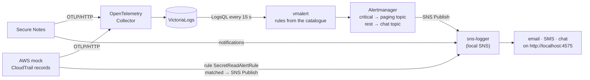
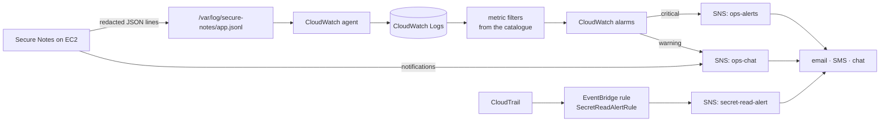
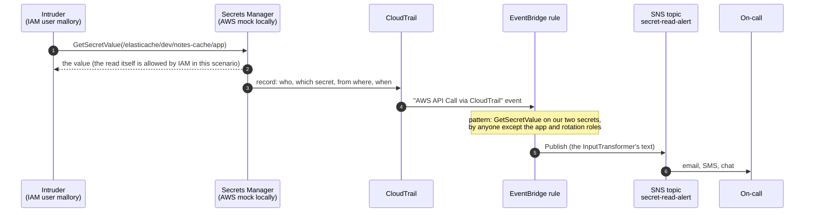
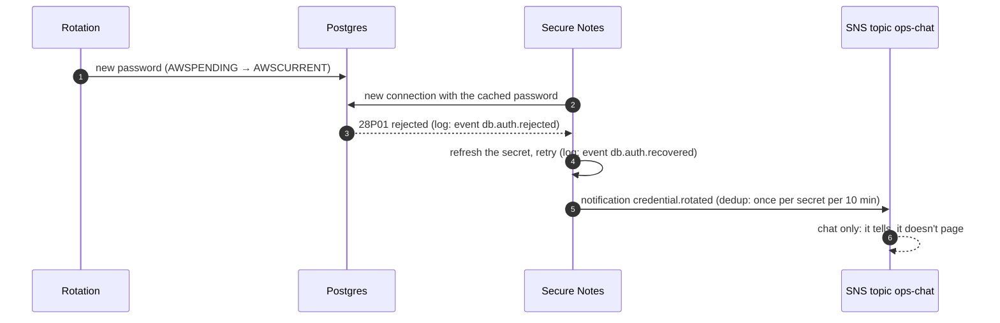

# 7. Alerts and audit: from a log line to an SMS

[← 6. Request flows](06-request-flows.md) · [Learning path](README.md) · Reference: [alert catalogue](../reference/alerts.md)

**What you'll learn:** how a problem in the app, or a secret read by the wrong identity,
becomes an email, a text message and a chat post. How to build that path so it can't
leak a secret. How to run the whole thing on a laptop, using the same rule AWS runs.

## 7.1 Two sources, one rule: logs first

There are two kinds of alert, and each has a natural source:

| What went wrong | Who knows | Source of the alert |
| --- | --- | --- |
| The app can't read a credential, keeps hitting rejected passwords, refused to start | **the app** | its own log lines |
| Someone read a secret who shouldn't have | **the platform**, not the app (the app never sees other people's reads) | the audit trail: CloudTrail |

In both cases the alert is raised **from a record**, not from code that pages someone.
The app writes a log line with a stable `event` name, and a rule outside the app decides
whether that is an alert. That has three benefits:

- the app stays simple and can't page twice for the same problem;
- the rule can count ("3 rejections in 5 minutes") and group;
- the record stays behind as evidence after the alert.

The app publishes to SNS itself only for **notifications**, where it tells rather than
pages: "I switched to a rotated credential", and the test button.

## 7.2 A log line built for alerting

```json
{"time":"2026-10-18T14:52:12.173Z","level":"error","app":"secure-notes","component":"secrets",
 "secretId":"/rds/dev/notes-db/app","err":{"name":"TimeoutError","message":"…"},
 "event":"secrets.fetch.failed","msg":"secret fetch failed"}
```

- **`event`** is the contract between the code and the rules. Each name is listed once,
  in `backend/src/alerts/catalogue.js`, with its severity, channels, threshold and
  first action. A unit test fails if the code logs an event name the catalogue doesn't list.
- **The line is redacted before it goes anywhere.** Every copy (stdout, the log file on
  EC2, the OpenTelemetry shipper) receives the same already-scrubbed string. Lines printed
  by the lab-only reveal flag go to stdout only; no log store ever receives them.
- **Shipped in the OpenTelemetry format** (a CNCF standard), so any log store can take it:

| Log line field | OpenTelemetry log record |
| --- | --- |
| `time` | Timestamp |
| `level` | SeverityNumber / SeverityText (info 9, warn 13, error 17; 21 for the two fatal exits) |
| `msg` | Body |
| `event` | EventName (also kept as an attribute) |
| everything else | Attributes (`err.code`, `secretId`, …) |
| — | Resource: `service.name=secure-notes`, `service.version`, `deployment.environment.name` |

For a terminal, `LOG_FORMAT=pretty` prints the same record on one readable line.
Production refuses it, because log stores and rules read JSON.

## 7.3 The two pipelines

**On a laptop** (Docker Compose with `docker-compose.observability.yml`):



**On AWS** (`infra/cloudformation.yaml`):



The parts map one to one. One script, `scripts/sync-alert-rules.js`, writes the local
vmalert rules, the CloudWatch metric filters and alarms, and the table in the
[alert catalogue](../reference/alerts.md), so they can't drift apart.

## 7.4 Who read the secret? The unexpected-read alarm



Locally, the AWS mock plays CloudTrail and EventBridge. It reads the dummy access key
as the caller's identity (`local-app` is the app's role, `local-intruder-user` is
mallory), writes a CloudTrail-shaped record without the value, and evaluates **the same
rule**. `scripts/sync-event-pattern.py` copies the rule from the CloudFormation template,
and CI fails if the copy goes stale.

Building that simulation found **two bugs** in the AWS version, which could never have fired:

1. **EventBridge doesn't deliver read-only events to an ordinary rule.** `GetSecretValue`
   is a read-only management event; a rule must be in state
   `ENABLED_WITH_ALL_CLOUDTRAIL_MANAGEMENT_EVENTS` to receive it. The local evaluator
   applies the same rule, so the button stayed silent until the template was fixed.
2. **The topic used the AWS-managed `aws/sns` key.** EventBridge and CloudWatch alarms
   can't use that key, so their publishes fail. The alert topics now use a
   customer-managed key that allows both services.

There is also one **known gap**, shown on purpose. The rule matches the RDS-managed secret
by ARN, so a read that names it by its name is recorded but not alarmed. The detection
lab's "Read DB secret by name" button demonstrates it.

## 7.5 A rotation, told to chat



A single rejection that recovers doesn't page anyone. Three rejections in five minutes
mean the secret and the database disagree, and the `db.auth.rejected` rule raises a warning.

## 7.6 Who gets what

| Topic | Receives | Email | SMS | Chat |
| --- | --- | --- | --- | --- |
| `secure-notes-secret-read-alert` | unexpected reads | ✓ | ✓ | ✓ |
| `secure-notes-ops-alerts` | critical alarms, test alert | ✓ | ✓ | ✓ |
| `secure-notes-ops-chat` | warnings, notifications | (only if no chat endpoint) | | ✓ |

Each notification the app publishes has three bodies in one SNS message
(`MessageStructure=json`):

- an **email** with what happened, where, when, the details, an alert ID and a runbook link;
- a **text** that fits in 140 bytes;
- a **chat card** in the Amazon Q Developer custom-notification format. SNS cannot post
  to Slack or Teams directly; on AWS, connect the topic in Amazon Q Developer in chat
  applications.

Recipients appear masked everywhere they show up, as `on****@example.com` and
`+1******0100`. They are SNS subscriptions, never part of the app's configuration.
On AWS, US numbers can't show a sender ID, and a new account starts in the SMS sandbox,
where it can text only verified numbers.

## 7.7 Try it

```bash
docker compose -f docker-compose.yml -f docker-compose.observability.yml up --build
# dashboard:            http://localhost:3000   → Detection lab
# notification console: http://localhost:4575   → Email · SMS · Chat · Pipeline
# log store:            http://localhost:9428/select/vmui
```

In the dashboard's **Detection lab**:
- "Read Redis secret as IAM user mallory" raises the alarm; the email, the SMS and the chat
  post appear on the console a second later.
- "Read DB secret by name" shows the known gap: the read is recorded, but no alarm fires.
- "Send a test alert" goes through the app's notifier.

To see the log path, stop the mock (`docker compose stop aws-mock`) and press **Refresh
now** on the database secret. The failure is logged with `event=secrets.fetch.failed`,
and vmalert, Alertmanager and SNS turn it into a critical alert within about a minute.
`scripts/pipeline-check.sh` does exactly this in CI.

## Sources

- [OpenTelemetry logs data model](https://opentelemetry.io/docs/specs/otel/logs/data-model/) · [messaging semantic conventions](https://opentelemetry.io/docs/specs/semconv/registry/attributes/messaging/)
- [EventBridge: read-only CloudTrail management events](https://docs.aws.amazon.com/eventbridge/latest/userguide/eb-service-event-cloudtrail-management.html) · [event pattern operators](https://docs.aws.amazon.com/eventbridge/latest/userguide/eb-create-pattern-operators.html)
- [SNS: encrypted topics and key policies](https://docs.aws.amazon.com/sns/latest/dg/sns-key-management.html) · [Publish](https://docs.aws.amazon.com/sns/latest/api/API_Publish.html) · [SMS](https://docs.aws.amazon.com/sns/latest/dg/sms_publish-to-phone.html) · [email notifications](https://docs.aws.amazon.com/sns/latest/dg/sns-email-notifications.html)
- [CloudWatch agent configuration](https://docs.aws.amazon.com/AmazonCloudWatch/latest/monitoring/CloudWatch-Agent-Configuration-File-Details.html) · [metric filter syntax](https://docs.aws.amazon.com/AmazonCloudWatch/latest/logs/FilterAndPatternSyntax.html)
- [VictoriaLogs](https://docs.victoriametrics.com/victorialogs/) · [vmalert with VictoriaLogs](https://docs.victoriametrics.com/victorialogs/vmalert/) · [Alertmanager SNS receiver](https://prometheus.io/docs/alerting/latest/configuration/)
- [Amazon Q Developer in chat applications: custom notifications](https://docs.aws.amazon.com/chatbot/latest/adminguide/custom-notifs.html)
