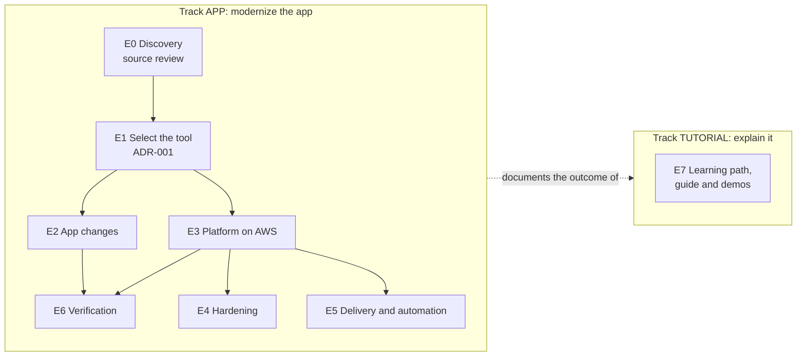

# Initiative: modernize how Secure Notes handles credentials

**Goal:** no human ever handles, and no environment ever exposes, a production credential.
Secure Notes reads its database and cache credentials at runtime from a central secrets
manager, proves who it is with a platform identity, and keeps working through rotation.

**Problem:** the initial version read long-lived passwords from a `.env` file. Anyone with
access to the host, the container runtime, the orchestrator, CI logs or backups could read
them; they were never rotated, and nobody could tell who had read them
([source review](01-source-review.md)).

## Success measures

| Measure | Target | How it is checked |
| --- | --- | --- |
| Credentials in environment, files, images, logs or Kubernetes objects | 0 | The credential scan searches for the real values on every CI run |
| Restarts needed to rotate a credential | 0 | Rotation tests on Compose, kind and (manually) AWS |
| Secret reads not authenticated by a platform identity | 0 | No access keys anywhere; IAM role or JWT-based identity only |
| Secret reads not audited | 0 | CloudTrail records every `GetSecretValue`; an alarm fires on unexpected readers |
| Credentials created, typed or copied by a person | 0 | Created by RDS, CloudFormation and rotation functions only |

## How the work is organized

Epics hold features; features hold user stories with acceptance criteria. The full list,
with status and evidence, is in the [backlog](backlog.md), and every item is a GitHub
issue with its features and stories as sub-issues.

The work runs in **two tracks**, so the modernization never mixes with the effort of
explaining it:

| Track | Issue prefix and label | What it is | Epics | Issues |
| --- | --- | --- | --- | --- |
| **APP** | `APP:` · `app` | Modernizing the app: what a team does when asked to move an application from `.env` passwords to a secrets manager | E0–E6 | [all](https://github.com/ephico2real2/aws-secrets-manager-node-poc/issues?q=is%3Aissue+label%3Aapp) · [open](https://github.com/ephico2real2/aws-secrets-manager-node-poc/issues?q=is%3Aissue+label%3Aapp+is%3Aopen) |
| **TUTORIAL** | `TUTORIAL:` · `tutorial` | Building this tutorial about it: the learning path, the live `.env` demo, the guide, the demo pages | E7 | [all](https://github.com/ephico2real2/aws-secrets-manager-node-poc/issues?q=is%3Aissue+label%3Atutorial) · [open](https://github.com/ephico2real2/aws-secrets-manager-node-poc/issues?q=is%3Aissue+label%3Atutorial+is%3Aopen) |

E0 then E1; E2 and E3 after E1; E4, E5 and E6 in parallel once E3 is in place. E7 follows
the APP track and documents what it delivered.

| Track | Epic | Outcome | Status |
| --- | --- | --- | --- |
| APP | E0 Discovery | The initial design reviewed; requirements R1–R6 | ✅ [Source review](01-source-review.md) |
| APP | E1 Select a secrets manager for AWS | Decision with criteria and consequences | ✅ [ADR-001](02-adr-001-secrets-manager-selection.md) |
| APP | E2 Application changes | The app fetches, caches, refreshes and redacts secrets; names follow a convention | ✅ |
| APP | E3 Platform on AWS | Identity, network path, encryption, managed rotation | ✅ |
| APP | E4 Security hardening | Resource policy, unexpected-read alarm, Config rules; least-privilege DB user, IAM auth, multi-region next | 🔎 S4.1, S4.2 built, verify on AWS · ✅ S4.3 (opt-in) · 🔜 S4.1b, S4.4–S4.6 |
| APP | E5 Delivery and automation | One build, CI, supply chain, keyless deploys | ✅ |
| APP | E6 Verification and evidence | Every claim has a test that fails if it stops being true | ✅ |
| TUTORIAL | E7 Learning path, guides and demos | A path a junior engineer can follow; the `.env` demo; guide, tutorial and demo pages | ✅ |

## Read in this order

1. [Source review](01-source-review.md): what was wrong with the initial design
2. [ADR-001](02-adr-001-secrets-manager-selection.md): which tool, and why
3. [Backlog](backlog.md): the epics, features and stories
4. The [learning path](../learn/README.md): the story for the whole team
